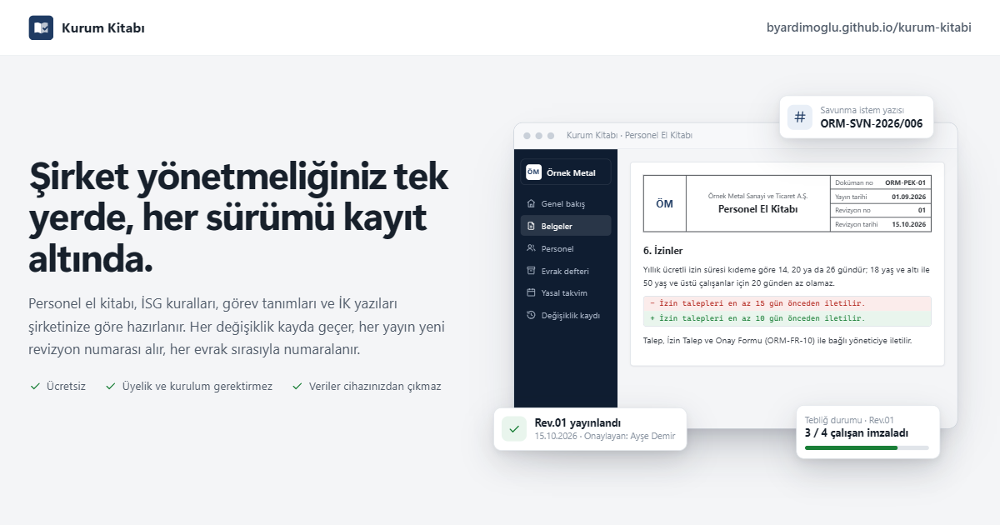

# Kurum Kitabı

Kurum Kitabı, şirketler için ücretsiz bir yönetmelik hazırlama aracıdır. Personel el kitabını, iş sağlığı ve güvenliği kurallarını ve bildirim formlarını şirketinize göre uyarlarsınız. Her değişiklik kayda geçer, yayınlanan her sürüm yeni bir revizyon numarası alır. Tarayıcıda çalışır; uygulama indirmeniz ya da üye olmanız gerekmez.

**Aç:** https://byardimoglu.github.io/kurum-kitabi/

## Ne işe yarar

Çoğu şirkette el kitabı ve İSG belgeleri dağınık Word dosyalarında durur. Hangi sürümün yürürlükte olduğu, neyin ne zaman ve kim tarafından değiştirildiği belli olmaz. Kurum Kitabı bu belgeleri tek yerde toplar:

- Şirket ünvanı, logo, sorumlular ve tehlike sınıfı bir kez girilir; tüm belgelere kendiliğinden yerleşir.
- Belgeler bölüm bölüm düzenlenir. Her kayıt, düzenleyenin adı ve saatiyle birlikte Değişiklik kaydına satır satır işlenir.
- Değişiklikler “taslak” olarak birikir. Yayınlandığında belge numarası artar (ORM-ISG-01 Rev.02 → Rev.03), yayın tarihi ve onaylayan kaydedilir.
- Eski sürümler saklanır; görüntülenebilir, yazdırılabilir ve sürümler arasındaki fark gösterilir.

## Belge kütüphanesi (32 hazır taslak)

**Politikalar ve el kitabı**
- **Personel El Kitabı:** işe başlama, çalışma saatleri, ücret, izinler, davranış kuralları, kılık kıyafet ve kişisel bakım (saç, sakal, kadın ve erkek çalışanlar), gizlilik, disiplin, işten ayrılma ve okudum-anladım beyanı
- **Görev Tanımları:** pozisyon bilgisi, amaç, görev ve sorumluluklar, yetkiler, aranan nitelikler ve İSG sorumlulukları; 10 örnek pozisyon ve tebliğ tutanağı
- **Çalışan KVKK Aydınlatma Metni** ve **Uzaktan ve Hibrit Çalışma Politikası**

**İş sağlığı ve güvenliği**
- **İSG Kuralları**, **Tehlikeli Durum**, **Ramak Kala** ve **İş Kazası** bildirim formları
- **KKD Teslim ve Zimmet Tutanağı**, **İSG Eğitim Katılım Formu**, **İş İzni Formu** (sıcak iş, yüksekte ve kapalı alanda çalışma), **Ziyaretçi Bilgilendirme ve Giriş Formu**

**İK yazıları** (antetli kâğıt düzeninde)
- Görevlendirme, Görev Değişikliği Bildirimi (4857 md. 22 kabul beyanıyla), Terfi, Yazılı Uyarı (İhtar), Savunma İstem, Çalışma Belgesi, Teşekkür ve Takdir, örnek İstifa Dilekçesi

**İK formları ve tutanaklar**
- İzin Talep ve Onay, Fazla Çalışma Onayı, Tutanak, Savunma Tutanağı, Zimmet Tutanağı, İşe Giriş ve İşten Çıkış kontrol listeleri, Deneme Süresi ve Performans Değerlendirme, Öneri ve Fikir Formu, Gizli Şikâyet ve Bildirim Formu, Çıkar Çatışması ve Hediye Beyanı

Eğitim sıklığı, eğitim süresi, periyodik muayene, risk değerlendirmesi yenileme süreleri ve iş güvenliği uzmanı belge sınıfı seçilen tehlike sınıfına göre yazılır. Şirkete özel talimat, yazı ve formlar da eklenebilir.

## Personel, evrak, tebliğ ve takvim

- **Personel kartları:** Çalışanların bilgileri bir kez girilir ya da Excel'den yapıştırılır. Kıdem ve 4857 md. 53'e göre yıllık izin hakkı (yaş kuralı dâhil) hesaplanır.
- **Evrak düzenle:** Yazı ya da form açılır, personel seçilir. Ad, pozisyon, işe giriş tarihi gibi alanlar kendiliğinden dolar; kalan boşluklar ekranda yazılır.
- **Evrak kayıt defteri:** Kaydedilen her evrak sayı alır, hangi belge sürümüyle düzenlendiği saklanır. Kayıtlar silinmez, gerekçesiyle iptal edilir. Çalışanın tüm evrakı kartında, belgenin evrakları belge sayfasında görünür.

### Evrak sayıları nasıl verilir?

Yazı ve form şablonları değişmez; her kullanım ayrı bir evraktır ve kendi sayısını ve tarihini alır. Sayıda şirket öneki, belge türünün kısaltması (SVN = savunma istem, GRV = görevlendirme, TRF = terfi, UYR = yazılı uyarı, IZN = izin…), yıl ve sıra yer alır. Kısaltma Belge ayarlarından değiştirilebilir. Şirket bilgileri → Evrak numaralama'dan kural seçilir:

| Kural | Örnek (3. savunma istem yazısı) |
|---|---|
| Her belge türü kendi sırasıyla, her yıl 1'den (varsayılan) | ORM-SVN-2026/003 |
| Her belge türü kendi sırasıyla, kesintisiz | ORM-SVN/003 |
| Tüm evraklar tek sırada, her yıl 1'den | ORM-2026/0012 |

Sisteme geçmeden önce kâğıt üzerinde evrak verdiyseniz, belgenin **Belge ayarları** penceresine verilen son sayıyı yazın; sıra onun üzerine devam eder (4 yazdıysanız ilk evrak 005 olur). Gerekirse sayı, evrak düzenlenirken elle de değiştirilebilir; aynı sayının iki kez kullanılmasına izin verilmez.

Not: Veriler tarayıcıda saklandığı için sayı sırası tek bilgisayar içindir. Aynı şirkette birden fazla bilgisayardan evrak düzenlenecekse tek bir bilgisayar evrak kaydı için kullanılmalı ya da yedekle aktarılmalıdır.
- **Tebliğ takibi:** Politika belgeleri yeni revizyon aldığında yeni sürümü hangi çalışanın imzalamadığı görünür; imza listesi basılır.
- **Yasal takvim:** Risk değerlendirmesi, acil durum planı, tatbikat, çalışanların İSG eğitimi ve periyodik muayenesi, deneme süresi bitişi, yıllık izin hakedişi ve belge gözden geçirme tarihleri hesaplanır; geciken ve yaklaşan işler genel bakışta görünür.

“Hangi form?” sayfası üç soruda doğru bildirim formunu gösterir ve panoya asılacak A4 afiş olarak yazdırılabilir.

## Yazdırma

Her belge A4 olarak yazdırılır ya da PDF'e kaydedilir. Her sayfada logo, şirket ünvanı, doküman numarası, yayın tarihi, revizyon numarası ve revizyon tarihi bulunan başlık tablosu tekrarlanır. Metin belgelerinde kapak, içindekiler, revizyon tablosu ve onay alanı yer alır. Yayınlanmamış değişiklik içeren belgeler “TASLAK” filigranıyla basılır. “Tüm seti yazdır” bütün belgeleri doküman ana listesiyle birlikte tek çıktıda toplar.

Sayfa numaraları güncel Chrome ve Edge'de görünür.

## Gizlilik ve yedek

Girdiğiniz bilgiler cihazınızdan çıkmaz. Sayfanın sunucusu yoktur ve hiçbir yere veri göndermez. Belgeler tarayıcının kendi belleğinde durur.

Tarayıcı verileri silinirse belgeler de silinir. Bu yüzden **Yedek → İndir** ile düzenli yedek alın. Yedek dosyası (.json) başka bir bilgisayarda **Yedek yükle** ile açılır.

Değişiklik kaydındaki ad, giriş ya da şifre olmadan yazılır; kimlik doğrulaması yapılmaz.

## Önemli not

Taslaklar 29.10.2026 itibarıyla yürürlükteki mevzuata göre hazırlanmış genel bilgilendirme metinleridir (4857, 6331, 5510 ve 6698 sayılı Kanunlar ile 7578 sayılı Kanun'la gelen analık ve babalık izni değişiklikleri dâhil). Hukuki danışmanlık yerine geçmez. Belgeleri yürürlüğe koymadan önce iş güvenliği uzmanınız ve hukuk danışmanınızla kontrol edin.

## Kendi kopyanı yayınlamak

Kurum Kitabı tek dosyalık bir web sayfasıdır (`index.html`). Bilgisayarda dosyayı çift tıklayarak da açabilirsiniz. İnternette yayınlamak için depoyu çatallayıp (fork) GitHub Pages'i açmanız yeterli.

## Lisans

Kod MIT lisanslıdır (`LICENSE`).

Berk Yardımoğlu tarafından ücretsiz sunulur.
